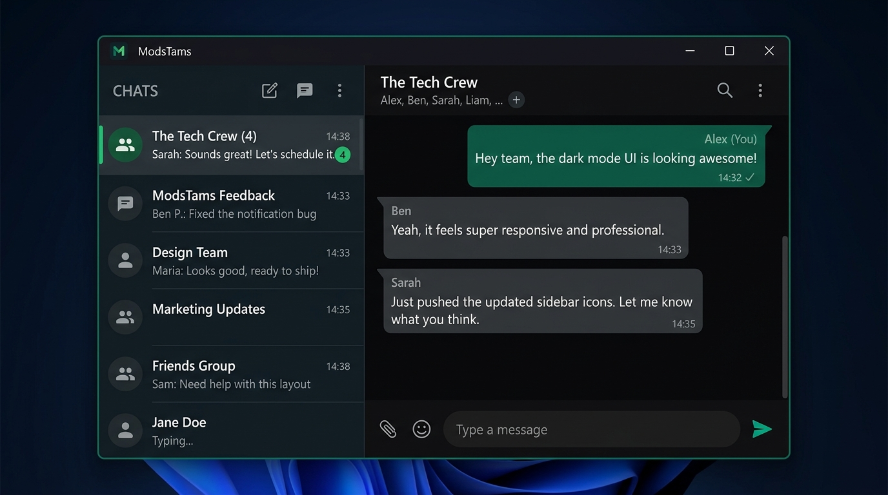
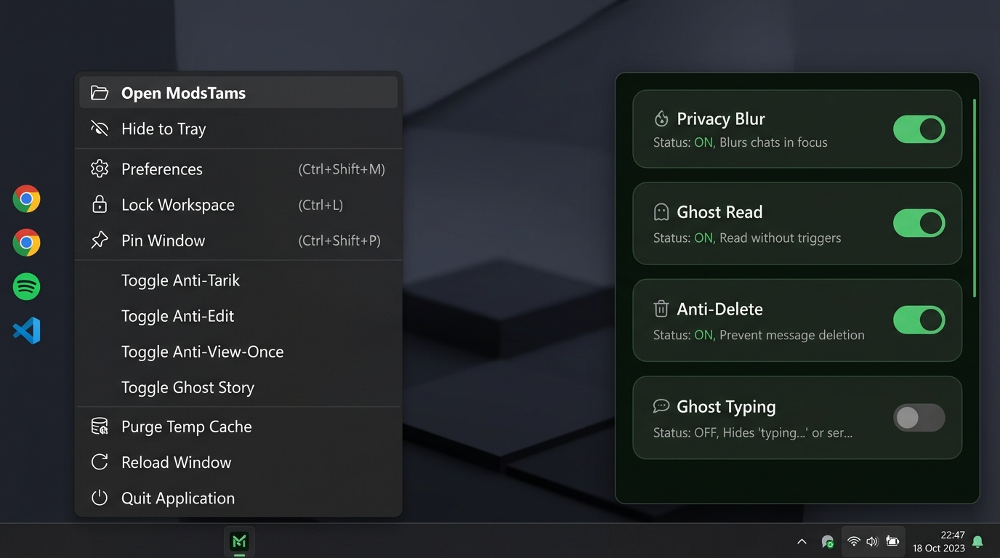
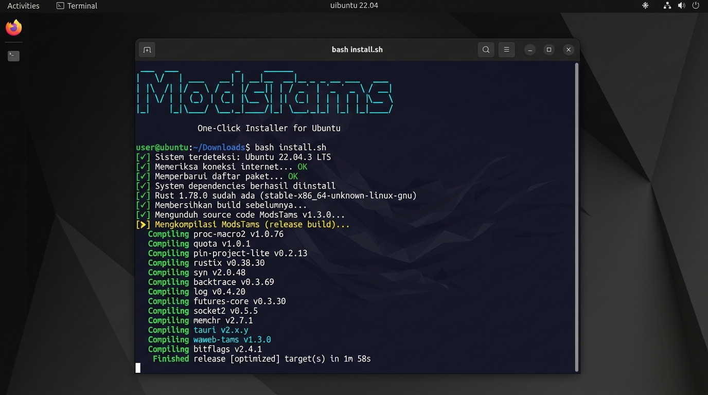

# ModsTams &mdash; Enterprise Ultra-Light Desktop Client

[](https://github.com/codewithtama/WAwebTams/actions/workflows/ci.yml)
[](https://www.rust-lang.org/)
[](https://v2.tauri.app/)
[](LICENSE)
[](https://github.com/codewithtama/WAwebTams)

A high-performance, ultra-lightweight desktop client wrapper for WhatsApp Web engineered with **Rust** and **Tauri v2**. Designed to slash memory consumption by **70%–80%** compared to standard Electron/Chromium distributions while providing an enterprise-grade productivity mod suite.

---

## Screenshots

### Main Window — Dark Mode


### System Tray Menu & Mod Control Panel


### Ubuntu One-Click Installer


---

## 🚀 Quick Install

### 🐧 Ubuntu / Linux — Satu Perintah, Langsung Jalan

```bash
git clone https://github.com/codewithtama/WAwebTams.git
cd WAwebTams
bash install.sh
```

Script otomatis menangani **semua** langkah tanpa perlu tahu apapun tentang Rust:
- ✅ Install GTK3, WebKit2GTK, AppIndicator3 via `apt`
- ✅ Install Rust toolchain via `rustup` (kalau belum ada)
- ✅ Build binary release (`cargo build --release`)
- ✅ Buat shortcut di **Desktop** & **Applications menu** yang bisa langsung diklik
- ✅ Tawarkan launch langsung setelah install selesai

> **Uninstall:** `bash uninstall.sh`

---

### 🪟 Windows — Download & Jalankan

Download `ModsTams.exe` dari [Releases](https://github.com/codewithtama/WAwebTams/releases) — tidak perlu install apapun, langsung klik dua kali.

Atau build dari source:
```bat
scripts\build-release.bat
```

---

## Technical Architecture

```
+--------------------------------------------------------------------------+
|                             ModsTams Host                                |
+------------------------------------+-------------------------------------+
|         Rust Native Host           |      Platform WebView Runtime       |
|  - Single Instance Enforcement     |  Windows: WebView2 (msedge)         |
|  - System Tray Management          |  Linux:   WebKitGTK 4.1             |
|  - Cross-Platform Cache Purge      |  - Memory-tuned runtime flags       |
|  - Platform RAM Optimizer          |  - Injected Mod Suite (Assets)      |
+------------------------------------+-------------------------------------+
                                      |
                                      v
                       +-----------------------------+
                       |   https://web.whatsapp.com  |
                       +-----------------------------+
```

### Architecture Highlights
- **Cross-Platform Native WebView**: WebView2 (Windows) / WebKitGTK 4.1 (Linux/Ubuntu) — no Electron, no bundled Chromium.
- **Aggressive RAM Management**:
  - Windows: Win32 `SetProcessWorkingSetSize` recursive trimmer across host + all `msedgewebview2.exe` child processes. Idle footprint: **~60MB–85MB**.
  - Linux: `MALLOC_ARENA_MAX=2` + `WEBKIT_DISABLE_COMPOSITING_MODE` to minimize glibc arena fragmentation and WebKitGTK compositor overhead.
- **Decoupled Modularity**:
  - `src-tauri/src/memory.rs`: Platform-gated memory optimization (Windows FFI / Linux no-op).
  - `src-tauri/src/storage.rs`: Cross-platform cache purge (XDG on Linux, LOCALAPPDATA on Windows).
  - `src-tauri/src/tray.rs`: System tray icon, context menu, and IPC dispatcher.
  - `src-tauri/src/window.rs`: Window lifecycle, script injection, minimize-to-tray.
  - `src-tauri/assets/`: Mod suite engine (`enhancements.js`) injected at compile time.

---

## Enterprise Engineering Documentation

Comprehensive blueprints under [`docs/`](docs/):

- 🏛️ **[System Architecture](docs/ARCHITECTURE.md)** &mdash; C4 breakdown, WebView sandbox, packet topology.
- 🛡️ **[Security Threat Model](docs/SECURITY_THREAT_MODEL.md)** &mdash; STRIDE analysis, zero-telemetry guarantee, memory invariants.
- ⚡ **[Mod Suite Specification](docs/MOD_SUITE_SPECIFICATION.md)** &mdash; All 15 mod capabilities, LRU limits, packet schemas.
- 💻 **[Developer Guide](docs/DEVELOPER_GUIDE.md)** &mdash; Environment setup, DevTools debugging, release verification.

---

## Repository Structure

```
WAwebTams/
├── .github/                      # CI/CD & Governance
│   ├── ISSUE_TEMPLATE/           # YAML Issue Forms (Bug / Feature RFC)
│   ├── workflows/
│   │   ├── ci.yml                # Multi-stage CI pipeline
│   │   └── release.yml           # Release publisher with SHA-256
│   ├── dependabot.yml
│   └── PULL_REQUEST_TEMPLATE.md
├── docs/
│   ├── screenshots/              # README screenshots
│   │   ├── main-window.jpg
│   │   ├── tray-and-mods.jpg
│   │   └── ubuntu-install.jpg
│   ├── ARCHITECTURE.md
│   ├── SECURITY_THREAT_MODEL.md
│   ├── MOD_SUITE_SPECIFICATION.md
│   └── DEVELOPER_GUIDE.md
├── scripts/
│   ├── build-release.bat         # Windows CMD release compiler
│   ├── build-release.ps1         # PowerShell release pipeline (SHA-256)
│   ├── build-release.sh          # 🐧 Linux/macOS release compiler
│   ├── run-dev.bat               # Windows dev server runner
│   ├── run-dev.sh                # 🐧 Linux/macOS dev server runner
│   ├── start-app.bat             # Windows app launcher
│   ├── start-app.sh              # 🐧 Linux/macOS app launcher
│   ├── clean.bat                 # Windows build artifact cleaner
│   ├── clean.sh                  # 🐧 Linux/macOS build artifact cleaner
│   ├── verify-env.ps1            # Windows toolchain diagnostic
│   └── verify-env.sh             # 🐧 Linux/macOS toolchain diagnostic (incl. GTK deps)
├── src-tauri/
│   ├── assets/
│   │   └── enhancements.js       # Injected mod suite engine (compile-time)
│   ├── icons/
│   ├── src/
│   │   ├── lib.rs                # Application orchestrator
│   │   ├── main.rs               # Entry point — cross-platform runtime flags
│   │   ├── memory.rs             # RAM optimizer (Windows Win32 / Linux no-op)
│   │   ├── storage.rs            # Cross-platform cache purge (XDG / LOCALAPPDATA)
│   │   ├── tray.rs               # System tray & IPC dispatcher
│   │   └── window.rs             # Window lifecycle & script injection
│   ├── Cargo.toml
│   └── tauri.conf.json
├── ui/
│   └── index.html
├── install.sh                    # 🐧 One-click Ubuntu/Linux installer
├── uninstall.sh                  # 🐧 Ubuntu/Linux uninstaller
├── package.json
├── CHANGELOG.md
├── CONTRIBUTING.md
├── LICENSE
├── README.md
└── SECURITY.md
```

---

## ModsTams Suite Features

| Mod Feature | Shortcut | Description |
| :--- | :--- | :--- |
| **Master Privacy Mode** | `Ctrl + B` | Sensor presisi modular untuk isi teks pesan, media, nama kontak, dan preview sidebar. |
| **Auto-Blur Media Saja** | `Ctrl + Shift + B` | Sensor otomatis foto, video, stiker, dan VN (hover untuk intip, emoji tetap tajam). |
| **Filter Chat Belum Dibaca** | `Ctrl + Shift + U` | Saring hanya percakapan unread via trigger native WhatsApp atau CSS pseudo-class `:has()`. |
| **Anti-Centang Biru (Ghost Read)** | `Ctrl + Shift + G` | Membaca pesan tanpa mengirim laporan terbaca (*read receipts*). |
| **Ghost Typing** | `Ctrl + Shift + T` | Menyembunyikan indikator *"Sedang mengetik..."*. |
| **Anti-Tarik Pesan (Anti-Delete)** | `Ctrl + Shift + D` | Intersepsi pesan yang ditarik pengirim, pulihkan teks aslinya dengan badge Linear-style, dan catat ke Revoked Log. |
| **Anti-Edit Inspector** | `Ctrl + Shift + E` | Rekam teks asli sebelum diedit pengirim, tampilkan perbandingan coretan teks asli (*strikethrough*), dan catat ke Edited Log. |
| **Anti-View-Once Destroyer** | `Ctrl + Shift + V` | Bypass pesan 1x lihat: putar ulang foto/video/VN tanpa batas via vault player dan simpan permanen. |
| **Invisible Story View** | `Ctrl + Shift + S` | Tonton story siapapun tanpa nama Anda muncul di daftar penonton (blokir receipt WebSocket). |
| **Freeze Last Seen (Zero Presence)** | `Ctrl + Shift + F` | Sembunyikan status *"Online"* dan bekukan jam terakhir dilihat tanpa memutus koneksi. |
| **Direct Chat** | `Ctrl + M` | Kirim pesan ke nomor baru tanpa perlu menyimpannya ke kontak. |
| **Pin Window (Always on Top)** | `Ctrl + Shift + P` | Pin jendela agar selalu melayang di atas aplikasi lain. |
| **Auto-Lock Saat Ditinggal** | *Otomatis* | Kunci layar otomatis dengan PIN jika tidak ada aktivitas (2m, 5m, 10m). |
| **App Lock & PIN Security** | `Ctrl + L` | Kunci layar seketika dengan PIN 4-digit kustom. |
| **Ultra Dark OLED Mode** | `Ctrl + Shift + O` | Mode Hitam Pekat `#000000` hemat daya dan kontras tinggi. |
| **Status Saver & View-Once** | *Otomatis* | Tombol unduh otomatis saat melihat story kontak dan media 1x lihat. |
| **ModsTams Quick HUD** | `Ctrl + Shift + M` | Popover kendali mod terpadu di navbar atas WhatsApp. |
| **One-Click Storage Purge** | `Ctrl + Shift + Del` | Bersihkan cache media, blobs, shader disk seketika tanpa logout (auto RAM trim). |

---

## Getting Started — Developer

### Prerequisites

**Windows:**
- [Rust Toolchain](https://rustup.rs/)
- [Node.js LTS](https://nodejs.org/)
- Visual Studio C++ Build Tools (MSVC)
- Microsoft Edge WebView2 Runtime (sudah include di Windows 11)

**Ubuntu / Linux:**
```bash
sudo apt install -y libgtk-3-dev libwebkit2gtk-4.1-dev libsoup-3.0-dev \
  libjavascriptcoregtk-4.1-dev libayatana-appindicator3-dev build-essential nodejs npm
```

### Development Server

```bash
# Windows
scripts\run-dev.bat

# Linux / macOS
bash scripts/run-dev.sh

# atau via npm (cross-platform)
npm run dev
```

### Production Build

```bash
# Windows
scripts\build-release.bat

# Linux / macOS
bash scripts/build-release.sh

# atau via npm
npm run build:portable        # Windows
npm run build:portable:linux  # Linux
```

### Verify Environment

```bash
npm run verify:env   # auto-detect platform (Windows → .ps1, Linux → .sh)
```

### Code Quality

```bash
npm run fmt          # format Rust
npm run fmt:check    # check format tanpa ubah
npm run lint         # clippy strict
npm run lint:all     # fmt:check + lint + JS syntax
```

---

## Quality Gates & CI/CD

Semua PR dan push ke `main` harus melewati:
1. **Formatting**: `cargo fmt --check` (0 diffs)
2. **Static Analysis**: `cargo clippy -- -D warnings` (0 warnings)
3. **JS Syntax**: `node --check src-tauri/assets/enhancements.js`
4. **Compilation**: Clean release build on `windows-latest`

---

## License

Didistribusikan di bawah lisensi [MIT](LICENSE).


